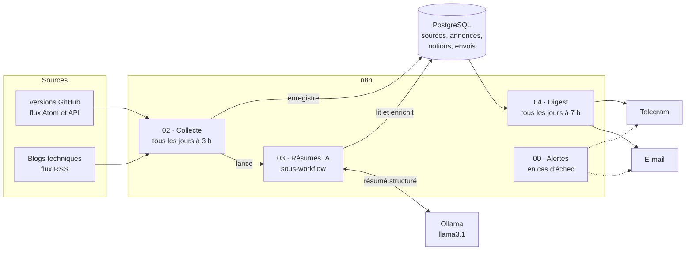

# Veille Data & IA


Pipeline de veille technique et d'apprentissage quotidien pour Data et AI Engineers. Chaque matin, il envoie sur Telegram et par e-mail :

- **une leçon** (« La notion du jour ») sur une notion technique, parmi 371 réparties en 35 modules ;
- **les nouveautés** de l'écosystème Data et IA (nouvelles versions, articles techniques), résumées en français par un LLM qui tourne en local.

Le projet est orchestré avec **n8n**, stocke ses données dans **PostgreSQL**, résume avec **Ollama** (`llama3.1`) et tourne en production sur un VPS, avec **Docker Compose**.

## Objectif du projet

**Le problème.** L'écosystème Data et IA évolue très vite : Kafka, Spark, Airflow, dbt, Iceberg, LangChain ou Ollama publient de nouvelles versions chaque semaine, et les blogs techniques sont nombreux. Suivre tout cela à la main prend du temps, et l'information utile se perd dans le bruit (annonces commerciales, versions de test, sous-paquets).

**Le but.** Recevoir chaque matin, en quelques minutes de lecture :

- l'essentiel des nouveautés des outils suivis, **déjà triées et résumées en français** ;
- **une leçon courte** pour progresser chaque jour sur les fondamentaux, pendant un an.

Le projet poursuit trois objectifs :

| Objectif | Ce que cela signifie |
|----------|----------------------|
| **Veille personnelle** | Suivre les technologies utilisées au quotidien, sans y consacrer du temps chaque jour |
| **Montée en compétence** | Apprendre n8n de A à Z en construisant le projet, puis consolider 35 domaines du Data Engineering et de l'IA grâce aux leçons quotidiennes |
| **Portfolio** | Montrer un pipeline de données complet, documenté et déployé en production : collecte, stockage, transformation par un LLM, diffusion, supervision |

**Les critères de réussite** fixés au cadrage :

- un digest reçu chaque matin à 7 h, sur Telegram et par e-mail ;
- aucune annonce reçue deux fois ;
- une nouvelle source ajoutée en moins de 5 minutes, sans modifier les workflows ;
- la panne d'une source n'empêche pas l'envoi du digest ;
- le projet ne ralentit pas les autres applications du serveur.

## Principe : l'apprentissage d'abord

Le digest doit d'abord aider à **comprendre comment fonctionnent** les technologies. Ce principe guide tous les choix :

- les sources retenues **expliquent** plutôt qu'elles n'annoncent : documentation officielle, blogs d'ingénierie, notes de version ; l'actualité commerciale est écartée ;
- chaque résumé se termine par **« La notion à retenir »**, qui explique un concept technique cité dans l'annonce ;
- les leçons sont **rédigées à l'avance et vérifiées**, et non générées par le LLM, pour ne jamais enseigner une erreur.

## Exemple de digest

```
La notion du jour (2/371)
Spark (1/10) : le driver et les executors

Définition
Une application Spark se compose d'un driver, qui organise le travail,
et d'executors, qui l'exécutent.

Comment ça marche
Le driver exécute ton programme principal : il transforme ton code en
plan de travail et le découpe en petites tâches. […]

Analogie
Un chef de chantier (le driver) qui répartit le travail entre des
ouvriers (les executors).

À retenir
Ramener une très grande quantité de données vers le driver (avec
collect(), par exemple) peut saturer sa mémoire. […]

Pour aller plus loin
```

```
Les nouveautés du jour (2)

IA et LLMOps
🆕 LangChain — langchain==1.5.0
<résumé en 2 ou 3 phrases, en français>
Notion à retenir : <la notion technique>

Orchestration et transformation
🆕 Apache Airflow — Apache Airflow 3.4.0
Apache Airflow 3.4.0 introduit les boucles de tâches, permettant de
répéter un groupe de tâches à la volée. […]
Notion à retenir : Boucles de tâches (Task Loops) : des groupes de tâches qui peuvent
être répétés à la volée, en fonction d'une condition définie. […]
```

## Architecture



Les workflows **communiquent par la base de données** : chaque annonce passe par trois états (collectée, résumée, envoyée), marqués par les colonnes `resume` et `envoyee_le` de la table `annonces`. Chaque workflow peut ainsi échouer ou être relancé sans dépendre des autres.

### Les workflows

| Workflow | Déclencheur | Rôle |
|----------|-------------|------|
| [`02-collecte-des-sources`](workflows/02-collecte-des-sources.json) | Tous les jours à 3 h | Lit les sources actives dans la table `sources`, filtre chaque flux avec sa propre expression régulière, normalise les annonces, les enregistre sans doublon, puis lance les résumés |
| [`03-resumes-ia`](workflows/03-resumes-ia.json) | Appelé par le 02 | Envoie chaque nouvelle annonce à Ollama, une à la fois, et enregistre le résumé et la notion à retenir |
| [`04-digest-quotidien`](workflows/04-digest-quotidien.json) | Tous les jours à 7 h | Envoie la leçon du jour et les nouveautés : deux messages Telegram et un e-mail |
| [`00-alertes`](workflows/00-alertes.json) | Échec d'un workflow | Alerte sur Telegram et par e-mail, avec le workflow, le nœud et l'erreur |
| [`01-test-lecture-rss-kafka`](workflows/01-test-lecture-rss-kafka.json) | Manuel | Premier exercice du projet, non utilisé en production |

### Choix techniques

| Exigence | Solution |
|----------|----------|
| Ajouter une source sans modifier le workflow | Sources décrites dans une table : une ligne par source, avec son URL, sa catégorie, son filtre et un interrupteur `actif` |
| Jamais deux fois la même annonce | Contraintes d'unicité sur la clé et sur le lien de l'annonce, et insertion avec « Skip on Conflict » (`ON CONFLICT DO NOTHING`) |
| Relancer sans risque | Pipeline **idempotent** de bout en bout, y compris une seule leçon par jour même en cas de relance |
| Une source en panne ne bloque pas les autres | Erreurs isolées par nœud (« On Error : Continue »), nouvelles tentatives automatiques |
| Résumés fiables | Prompt système, température basse, **sortie structurée** imposée par un schéma JSON, contenu coupé à 6 000 caractères pour respecter la fenêtre de contexte |
| LLM partagé avec d'autres projets sur le VPS | Annonces envoyées une par une, délai de 30 minutes, traitement de nuit avec 4 heures de marge avant l'envoi |
| Messages Telegram limités à 4 096 caractères | Découpage automatique du digest par un nœud Code |
| Aucun secret dans le dépôt | Variables d'environnement (`.env`), credentials chiffrés par n8n, workflows exportés sans données personnelles |

## La notion du jour

**371 leçons en 35 modules**, une par jour, en alternant les modules : Kafka 1, Spark 1, IA 1, Docker 1… puis Kafka 2, et ainsi de suite. Après la dernière leçon, le parcours **reboucle**, pour revoir chaque notion une fois par an.

| Domaine | Modules |
|---------|---------|
| Données et modélisation | SQL · PostgreSQL · Bases de données · Stockage et architectures · Lakehouse · Modélisation · Formats de fichiers · Qualité des données |
| Traitement | Spark · Spark avancé · Kafka · Kafka avancé · Streaming · Orchestration et transformation · Airflow et dbt · Pipelines scalables |
| Plateformes | Docker · Kubernetes · Cloud · Linux et réseau · Git et CI/CD · Observabilité |
| Langages et fondamentaux | Python · Scala et Maven · n8n · API et intégration · Algorithmes et structures de données · Statistiques |
| IA | IA · IA approfondie · Machine learning · LLMOps |
| Cadre et métier | Visualisation · Gouvernance et sécurité · Métier de data engineer |

Chaque leçon suit le même format (définition, fonctionnement, analogie, à retenir, lien de référence vérifié) et s'appuie, quand c'est possible, sur une situation réelle du projet. Les leçons sont dans [`data/notions.json`](data/notions.json).

## Sources de veille

- **13 sources actives** : versions d'Airflow, dbt, Dagster, Kafka, Spark, Iceberg, Delta Lake, LangChain, Chroma et Ollama ; blogs de la fondation Apache, de Confluent et de Databricks.
- **30 sources complémentaires**, vérifiées et prêtes à être activées : annonces et failles de sécurité de tout l'écosystème Apache, blogs d'ingénierie, IA, conteneurs, langages.

Chaque source a été testée, et les candidats écartés sont listés avec leur raison : voir [`docs/sources.md`](docs/sources.md).

## Structure du dépôt

```
├── docker-compose.yml        # n8n et PostgreSQL (le même fichier en développement et en production)
├── .env.example              # modèle des variables d'environnement
├── init-db/                  # création de la base, schéma, données (exécutés au premier démarrage)
├── data/
│   ├── sources.json          # les 43 sources de veille
│   └── notions.json          # les 371 leçons
├── workflows/                # les workflows n8n, exportés sans secret
├── scripts/
│   ├── generer_donnees_sql.py    # sources et leçons → init-db/03-donnees.sql
│   ├── exporter_workflows.py     # n8n → workflows/
│   └── sauvegarder_base.sh       # sauvegarde quotidienne des bases
└── docs/
    ├── cadrage.md                # objectifs, contraintes, décisions
    ├── sources.md                # sources retenues et écartées
    ├── deploiement.md            # mise en production sur le VPS
    └── ressources-apprentissage.md   # 93 lectures d'approfondissement
```

## Lancer le projet en local

Prérequis : Docker, et [Ollama](https://ollama.com) avec le modèle `llama3.1` (`ollama pull llama3.1`).

```bash
git clone https://github.com/GuyMartial24/veille-data-ia.git
cd veille-data-ia
cp .env.example .env      # puis remplir les valeurs « a_remplacer »
docker compose up -d
```

Au premier démarrage, PostgreSQL crée la base `veille`, son schéma, et charge les sources et les leçons. n8n est alors accessible sur http://localhost:5678 : créer le compte, importer les workflows du dossier `workflows/`, puis créer les credentials (PostgreSQL, bot Telegram, SMTP).

Le déploiement en production (VPS, tunnel SSH, transfert des credentials, initialisation, sauvegarde) est décrit dans [`docs/deploiement.md`](docs/deploiement.md).

## Démarche

Le projet a été construit **étape par étape**, avec un double objectif : obtenir un outil utile au quotidien, et apprendre n8n en profondeur. Chaque étape est documentée dans [`docs/cadrage.md`](docs/cadrage.md) :

1. Cadrage : objectifs, contraintes d'un VPS partagé, choix du modèle après des tests de vitesse et de qualité
2. Vérification des sources : flux introuvables, filtres par source, pièges des API
3. Environnement Docker Compose
4. Premier flux de bout en bout : une source, un message Telegram
5. Toutes les sources, pilotées par une table, avec dédoublonnage
6. Résumés pédagogiques par l'IA et « La notion du jour »
7. Digest Telegram et e-mail, horaires, déploiement en production
8. Robustesse : alertes, tolérance aux pannes, sauvegardes

## Pistes d'évolution

- Activer les 30 sources complémentaires
- Regrouper les failles de sécurité par projet dans le digest
- Classer les annonces par l'IA (sécurité, nouveauté, article de fond)
- Interroger l'historique de la veille depuis Telegram, avec un agent RAG (pgvector et `bge-m3`)
- Copier les sauvegardes hors du VPS

## Auteur

Conçu et développé par [GuyMartial24](https://github.com/GuyMartial24).
